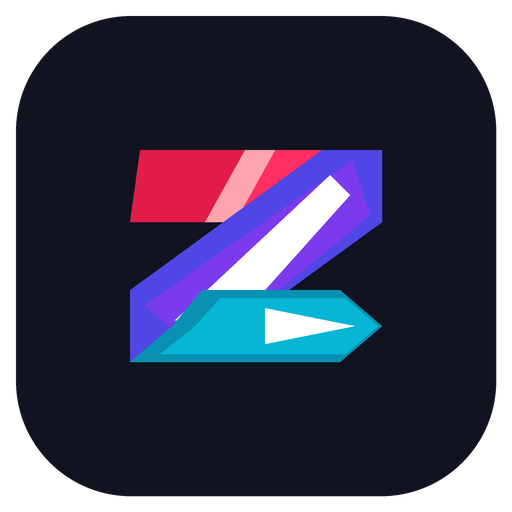

# ZenYomi (全読み)

### The Ultimate Unified Video Streaming & Content Reading Application for Android
*Taking the best of Tachiyomi, Mihon, and Aniyomi into one next-generation powerhouse.*

## Overview

**ZenYomi** (derived from Japanese **全** "Zen" meaning All/Omni/Universal and **読み** "Yomi" meaning Reading/Media Experience) brings together the best features and foundation of **Tachiyomi** and **Mihon** (the premier Android content readers) alongside **Aniyomi** (the video player and media streaming powerhouse) into a single, high-performance, modern Android application.

## Key Features

### 📖 Complete Content Reader (Tachiyomi & Mihon Foundation)
- **Multi-Mode Reader**: Left-to-Right, Right-to-Left (traditional content), Vertical, and Webtoon continuous scrolling with seamless page stitching.
- **Visual Enhancements**: Automatic border cropping, custom background colors, split dual-page spread in landscape, color filters (inverted, grayscale, sepia, AMOLED black).
- **Offline Reading**: Batch download chapters for offline reading with background download manager.
- **Local Content Support**: Read local archives (ZIP, CBZ, CBR, EPUB) and image folders.

### 🎬 Advanced Video Player (mpv Backend & Media Engine)
- **High-Performance Player Backend**: Built on MPV (`mpvKt`) with hardware decoding and smooth up to 120Hz display refresh rate.
- **Intuitive Gesture Controls**:
  - **Long-Press to Speed Up (2.0x)**: Press and hold anywhere on the screen during playback to temporarily boost speed with on-screen HUD badge and haptic feedback.
  - Vertical swipe left: Screen brightness control
  - Vertical swipe right: Audio volume control (with volume boost cap)
  - Horizontal swipe: Smooth seeking
  - Double tap left/right: Configurable fast forward and rewind
  - Pinch-to-zoom: Aspect ratio modes (Fit, Stretch, Crop, 16:9, Original)
- **Audio & Subtitle Controls**: Multi-audio track switching (Dub/Sub) and styled subtitles (internal ASS/SSA/SRT/VTT and external subtitle tracks).
- **Stream Quality**: Direct quality selector (1080p, 720p, 480p, 360p, Auto).
- **Smart Features**: AniSkip integration (auto-skip video openings and endings), Picture-in-Picture (PiP), and background audio playback.
- **Episode Downloads**: Download video streams directly for offline viewing.

### 📊 Universal Tracking & Sync
- **Tracking Services**: Full bi-directional sync with AniList, MyAnimeList (MAL), Kitsu, Shikimori, and Bangumi.
- Automatically marks chapters read and video episodes watched as you finish them.

### 🎨 Modern Jetpack Compose UI
- Material 3 & Material You dynamic color theming.
- Pitch Black AMOLED Dark Mode for battery saving.
- Biometric & PIN App Lock for privacy.
- Automated JSON/Protobuf Backup & Restore across devices.

## Getting Started

Welcome to **ZenYomi**! Follow these steps to set up your library:

1. **Add Extension Repositories**:
   - Open **Browse → Extensions** (for Manga or Anime) → tap the **⋮ (Menu)** → **Extension repos** → **Add**, and paste your preferred Tachiyomi/Mihon/Aniyomi extension repo URL (or install CloudStream providers via **More → Settings → Browse**).
2. **Install Sources**:
   - Go to **Browse → Manga Extensions** or **Anime Extensions** and install the sources you want to use.
3. **Add Series to Your Library**:
   - Open any installed source in **Browse → Sources**, search for a title, and tap **Add to library** to track new chapters/episodes and customize categories.
4. **Configure Reader & Player**:
   - Customize reading modes in **More → Settings → Reader** and video playback (MPV / ExoPlayer, subtitles, audio tracks, and speeds) in **More → Settings → Player**.

### Tracking
Connect **AniList**, **MyAnimeList**, **Kitsu**, **Shikimori**, or **Bangumi** in **More → Settings → Tracking** to automatically sync chapters read and episodes watched.

### Local Manga
Place manga archives (`.cbz`, `.cbr`, `.zip`, `.epub`) or image folders inside `<ZenYomi folder>/local/` on your device storage, then open **Browse → Sources → Local manga source**.

### Local Anime
Place video files (`.mp4`, `.mkv`, etc.) inside `<ZenYomi folder>/localanime/` organized by series folder, then open **Browse → Sources → Local anime source**.

### Migration
Use **Browse → Migrate** to transfer a manga or anime from an old/broken source to a working source while keeping your reading/watching progress and categories.

### Bulk Updates
Configure automatic library update intervals, Wi-Fi-only restrictions, and smart update exclusions in **More → Settings → Library**.

### Custom Buttons
Add custom MPV Lua/player action buttons in **More → Settings → Player → Custom buttons** for quick gestures or scripts during playback.

### Troubleshooting
- **Cloudflare / WebView Errors**: Open the series **WebView** icon to complete any browser check, then refresh.
- **"Refresh Chapter List" Errors**: Pull down to refresh the series entry (ZenYomi also auto-refreshes the chapter list on page load failure).
- **Video Playback Issues**: Try switching between **ExoPlayer** and **MPV** in **More → Settings → Player** (ZenYomi also supports automatic codec failover).

## Acknowledgements & Inspirations

ZenYomi stands on the shoulders of giants. Special thanks and deep appreciation to the open-source projects that inspired and paved the way:
- [**Tachiyomi**](https://github.com/tachiyomiorg) — The original pioneer in open-source content reading for Android.
- [**Mihon**](https://github.com/mihonapp/mihon) — The community successor keeping the modern Android content reading experience alive and thriving.
- [**Aniyomi**](https://github.com/aniyomiorg/aniyomi) — The visionary video player and media streaming fork.
- [**CloudStream 3**](https://github.com/recloudstream/cloudstream) — High-performance media provider architecture and plugin framework.

## Disclaimer

- **Content & Hosting**: ZenYomi is an independent open-source reader utility and media player. It does **not** host, store, index, or distribute any media files, video streams, or content chapters on its servers or within its source code.
- **Third-Party Extensions**: All media sources and extensions are developed, maintained, and hosted by independent third parties. ZenYomi is not affiliated with, nor does it endorse or control, any content provider or third-party extension repository.
- **Copyright & Compliance**: All media accessed through user-configured extensions remains the copyrighted property of their respective owners and publishers. Users are solely responsible for ensuring that their use of external sources complies with their local copyright and intellectual property laws.
