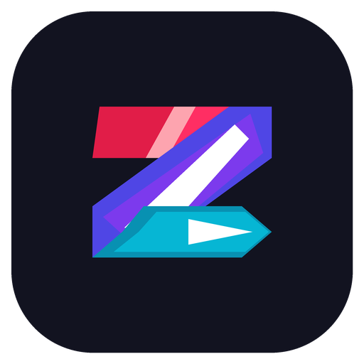

# ZenYomi (全読み)

### The Ultimate Unified Anime Streaming & Manga Reading Application for Android
*Taking the best of Tachiyomi, Mihon, and Aniyomi into one next-generation powerhouse.*

## Overview

**ZenYomi** (derived from Japanese **全** "Zen" meaning All/Omni/Universal and **読み** "Yomi" meaning Reading/Media Experience) brings together the best features and foundation of **Tachiyomi** and **Mihon** (the premier Android manga readers) alongside **Aniyomi** (the anime player and media streaming powerhouse) into a single, high-performance, modern Android application.

## Key Features

### 📖 Complete Manga Reader (Tachiyomi & Mihon Foundation)
- **Multi-Mode Reader**: Left-to-Right, Right-to-Left (traditional Japanese manga), Vertical, and Webtoon continuous scrolling with seamless page stitching.
- **Visual Enhancements**: Automatic border cropping, custom background colors, split dual-page spread in landscape, color filters (inverted, grayscale, sepia, AMOLED black).
- **Offline Reading**: Batch download chapters for offline reading with background download manager.
- **Local Manga Support**: Read local archives (ZIP, CBZ, CBR, EPUB) and image folders.

### 🎬 Advanced Anime Video Player (Aniyomi Media Engine)
- **High-Performance Player Backend**: Built on Media3 / ExoPlayer with hardware decoding.
- **Intuitive Gesture Controls**:
  - Vertical swipe left: Screen brightness control
  - Vertical swipe right: Audio volume control
  - Horizontal swipe: Smooth seeking
  - Double tap left/right: 10s fast forward and rewind
  - Pinch-to-zoom: Aspect ratio modes (Fit, Stretch, Crop, 16:9, Original)
- **Audio & Subtitle Controls**: Multi-audio track switching (Dub/Sub) and styled subtitles (internal ASS/SSA/SRT/VTT and external subtitle tracks).
- **Stream Quality**: Direct quality selector (1080p, 720p, 480p, 360p, Auto).
- **Smart Features**: AniSkip integration (auto-skip anime openings and endings), Picture-in-Picture (PiP), and background audio playback.
- **Episode Downloads**: Download video streams directly for offline viewing.

### 🌐 Pluggable Source & Extension System
- **Dual Extension Support**: Compatible with both Manga extension repositories and Anime extension repositories.
- **Source Extractors**: Automatically extracts and streams video links from major anime hosts.
- **Migration Assistant**: Easily migrate manga and anime titles between different sources when a source goes offline.

### 📊 Universal Tracking & Sync
- **Tracking Services**: Full bi-directional sync with AniList, MyAnimeList (MAL), Kitsu, Shikimori, and Bangumi.
- Automatically marks chapters read and anime episodes watched as you finish them.

### 🎨 Modern Jetpack Compose UI
- Material 3 & Material You dynamic color theming.
- Pitch Black AMOLED Dark Mode for battery saving.
- Biometric & PIN App Lock for privacy.
- Automated JSON/Protobuf Backup & Restore across devices.

## Acknowledgements & Inspirations

ZenYomi stands on the shoulders of giants. Special thanks and deep appreciation to the open-source projects that inspired and paved the way:
- [**Tachiyomi**](https://github.com/tachiyomiorg) — The original pioneer in open-source manga reading for Android.
- [**Mihon**](https://github.com/mihonapp/mihon) — The community successor keeping the modern Android manga reading experience alive and thriving.
- [**Aniyomi**](https://github.com/aniyomiorg/aniyomi) — The visionary anime player and media streaming fork.

## Disclaimer

- **Content & Hosting**: ZenYomi is an independent open-source reader utility and media player. It does **not** host, store, index, or distribute any media files, video streams, or manga chapters on its servers or within its source code.
- **Third-Party Extensions**: All media sources and extensions are developed, maintained, and hosted by independent third parties. ZenYomi is not affiliated with, nor does it endorse or control, any content provider or third-party extension repository.
- **Copyright & Compliance**: All media accessed through user-configured extensions remains the copyrighted property of their respective owners and publishers. Users are solely responsible for ensuring that their use of external sources complies with their local copyright and intellectual property laws.

